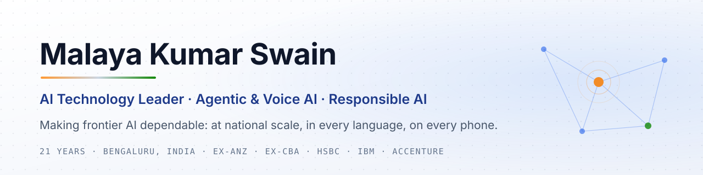

<picture>
  <source media="(prefers-color-scheme: dark)" srcset="assets/banner-dark.svg">
  
</picture>

  
  
  

### I make frontier AI dependable.

Frontier capability is easy to demo and hard to trust. For 21 years I have built the platforms that sit between powerful technology and the people who depend on it: first in banking data and regulation at ANZ, Commonwealth Bank and HSBC, then in GenAI platforms, and now in **agentic, voice-first consumer AI built for 400M+ people across 12+ Indian languages** at Jio Platforms.

I lead the whole system: architecture, product, delivery, security and the teams that build it.

---

### How I lead

| Principle | In practice |
|:--|:--|
| **Trust is architecture, not a feature** | Guardrails, privacy and human-in-the-loop governance are designed in from layer one, never bolted on after launch. |
| **Latency is a product decision** | A useful signal in two seconds on a 2G phone beats a perfect answer nobody waits for. |
| **Scale is a team sport** | The hardest system to align is the org chart. I have led 100+ people across vendors, time zones and three continents. |

---

### Selected impact

| Platform | Mandate | Outcome |
|:--|:--|:--|
| **Consumer agentic AI** · Jio Platforms · *2026–now* | Voice-first AI assistant for India: multi-agent orchestration, agentic RAG, MCP tools, real-time voice, Responsible AI and DPDP compliance | Built for **400M+ users** in **12+ languages**; leading a **17-member** cross-platform team |
| **GenAI master data** · Fortune 500 manufacturer · *2023–26* | Replace legacy MDM with a GenAI platform on AWS (LLM onboarding, RAG, MCP, guardrails, Spark) | **$1.5M+/yr** saved · **50M+ records, zero loss** · source onboarding **6+ weeks → 5 days** |
| **Regulatory data** · Commonwealth Bank · *2022–23* | Move APRA reporting from SQL to Spark on a governed Snowflake platform | Nightly batch **4 h → 28 min** · late regulatory submissions **−30%** |
| **Cloud data estate** · ANZ Bank · *2013–22* | Teradata → BigQuery migration with a 100+ person, five-vendor ecosystem | Query scan volume **−90%** · analyst queries **45 s → <3 s** · manual effort **−60%** |

---

### Building in the open

<table>
<tr>
<td width="50%" valign="top">

#### [Vismriti](https://github.com/Malaya-kumar-swain/vismriti)
**Consent, purpose limitation and right-to-erasure for RAG and AI agents, built for India's DPDP Act.**

Purpose-bound retrieval · erasure that propagates across vector stores, caches, agent memory and logs · signed deletion certificates · Indian PII masking · MCP server.

`Python` `RAG` `MCP` `Privacy engineering`

</td>
<td width="50%" valign="top">

#### [Kavach-Eval](https://github.com/Malaya-kumar-swain/kavach-eval)
**Red-team your AI assistant in the languages India actually speaks.**

Prompt-injection and data-leak probes in Hindi, Hinglish, Odia and Tamil · zero-width and look-alike obfuscation · indirect injection through RAG documents · judge-free scoring · a CI gate that blocks a release when any language leaks.

`Python` `AI security` `Red-teaming` `Indic languages`

</td>
</tr>
</table>

**Next:** Bharat Voice Eval, an open bench for Indian-language voice agents under code-mixed speech, 2G/3G latency and noisy audio.

---

### Where I go deep

**Agentic AI:** multi-agent orchestration (Google ADK), MCP, agentic RAG, LLM gateways and model routing 
**Voice AI:** real-time pipelines (LiveKit, WebRTC), multilingual and code-mixed speech, low-bandwidth UX 
**Responsible AI:** guardrails, prompt-injection defence, privacy by design, DPDP compliance, evaluation 
**Data and cloud:** AWS (Bedrock, EMR), GCP (BigQuery), Spark, Snowflake, OpenSearch, Qdrant 
**Delivery:** product strategy, SAFe portfolio planning, multi-vendor programmes, PMP

---

Career: Jio Platforms · Apptad · Commonwealth Bank of Australia · ANZ Bank · Accenture (Target) · IBM (Walmart) · HSBC · Effigent 
Credentials: PMP · SAFe 6.0 POPM · B.E. Information Technology 
Views and code here are my own.
